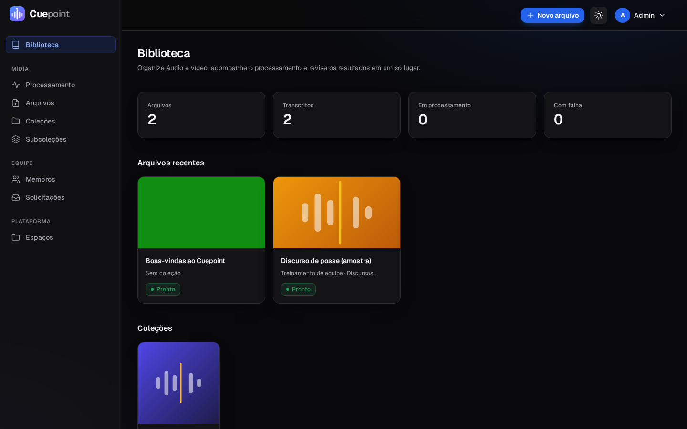

# Cuepoint

Biblioteca de mídia com processamento automatizado: envie áudio ou vídeo, acompanhe o processamento em segundo plano, revise e edite a transcrição com tempos e compartilhe por link temporário.

> O **case de engenharia** (padrões de comunicação, decisões, resultados medidos, capturas e vídeo) está em [`case-study/`](case-study/README.md).



## O que faz

- **Biblioteca** organizada em Coleções → Subcoleções → Arquivos, com áudio e vídeo.
- **Transcrição automática** com whisper.cpp (idioma automático): fila, worker separado, retry com backoff, falha visível com ação de reprocessar.
- **Acompanhamento ao vivo** da fila, do progresso e dos eventos (SSE e Socket.IO).
- **Revisão**: trechos com tempo (clique leva ao momento), edição com validação, histórico por arquivo e exportação em TXT, SRT e VTT.
- **Envio direto ao storage** (URL pré-assinada, em partes acima de 64 MiB) e **envio em lote** de até 20 arquivos.
- **Link temporário** de compartilhamento, com validade e revogação imediata.
- **Espaços de trabalho** isolados, com limites de arquivos e armazenamento.
- **Operação**: rotina noturna (02:00), reconciliação de jobs, backup com restauração verificada, métricas, alertas e logs com `traceparent`.
- Interface em português do Brasil, tema claro e escuro, responsiva.

## Arquitetura

```
Web (SvelteKit) ──► PostgreSQL (estado + EventLog)      ┌─► Realtime (Socket.IO) ─► navegador
       │            Storage S3 (arquivos)                │
       └─► fila Redis (Bull) ─► Worker de mídia ─► tópico de eventos ─┴─► Events (e-mail, métricas, histórico)
                                FFmpeg + whisper.cpp
```

- **web**: aplicação e API. Valida, registra o estado e enfileira; não processa mídia. Responde `202 Accepted` com `Location` e aceita `Idempotency-Key`.
- **worker** (`worker/index.ts`): processo separado. Baixa o áudio em streaming, converte, transcreve e só marca como concluído **depois de gravar o resultado**.
- **events** (`worker/subscribers.ts`): assinantes independentes do tópico de eventos.
- **realtime** (`realtime/`): publica o feed de atividade para a interface.
- Código compartilhado em `src/server/transcription/` (contratos, fila, estados, pipeline).

Os cinco padrões de comunicação (request-response, fila, pub/sub, streaming e batch) e as garantias de cada um estão descritos no [case](case-study/README.md).

## Rodando com Docker

```bash
cp .env.example .env          # troque os segredos
docker compose -f docker-compose.dev.yml up --build     # desenvolvimento (hot reload no web)
docker compose -f docker-compose.prod.yml up --build    # imagem de produção, local
```

| Serviço | Porta (host) |
|---|---|
| Web | 3300 |
| Realtime | 3301 |
| PostgreSQL | 5433 |
| Redis | 6380 |
| Storage S3 (RustFS) / console | 9000 / 9001 |

As migrações rodam sozinhas (serviço `migrate`). O bucket é criado pela aplicação no primeiro envio.
Dados de demonstração (administrador e um arquivo de exemplo):

```bash
docker compose -f docker-compose.dev.yml exec web npx tsx prisma/seed-admin.ts
docker compose -f docker-compose.dev.yml exec web npx tsx prisma/seed-demo.ts
```

Escalar workers: `docker compose -f docker-compose.prod.yml up --scale worker=2` (cada job usa ≈ 2 CPUs; regra prática: workers ≈ CPUs / 2).

## Desenvolvimento sem Docker

```bash
npm ci && npx prisma generate
npm run dev          # web
npm run worker       # worker (precisa de ffmpeg e whisper-cli locais; ver WHISPER_* no .env.example)
npm run check        # tipos (svelte-check)
npm run lint
npm run test:unit
```

## Testes

- **Unitários** (vitest): `npm run test:unit -- --run` — 131 testes.
- **E2E** (Playwright, navegador real contra a stack em Docker): com a stack no ar e os dados de demonstração, `npm run test:e2e` (com `E2E_BASE_URL` e `E2E_PASSWORD`, a senha do admin no `.env`). Sem instalar nada local, use o container oficial do Playwright na rede `cuepoint-network`, com `E2E_IN_CONTAINER=true`.
- **Caos**: `scripts/chaos-kill-worker.sh` derruba o worker no meio de um job e verifica a retomada sem duplicar a transcrição.

## Scripts de operação (`scripts/`)

| Script | Para quê |
|---|---|
| `backup.sh` | `pg_dump` atômico, mantém os N mais recentes |
| `restore-check.sh` | restaura o backup em um Postgres isolado e compara as contagens |
| `chaos-kill-worker.sh` | teste de caos do worker |
| `capacity.py` | medições de memória no envio, saturação do worker e transcrição longa |
| `smoke.sh` | teste de fumaça usado no deploy |

## CI/CD

`.github/workflows/`: **CI** (migrações do zero, tipos, lint, unitários, E2E, caos, backup/restauração, `npm audit` e varredura das imagens), **release** (uma imagem por componente, construída uma vez) e **deploy** (staging → produção com a mesma imagem, teste de fumaça e rollback automático). Os workflows foram escritos e os comandos rodam localmente, mas ainda não foram executados no GitHub.

## Estrutura

```
src/            aplicação SvelteKit (rotas, componentes, código de servidor)
worker/         worker de mídia e assinantes de eventos
realtime/       serviço Socket.IO
prisma/         schema, migrações e seeds
scripts/        backup, restauração, caos, capacidade e fumaça
tests/e2e/      testes de ponta a ponta
case-study/     capturas, vídeo e texto do case de engenharia
```

## Segurança

Segredos nunca entram na imagem (`.dockerignore`) nem no repositório: use o `.env` local. Autorização é central (por rota e por espaço de trabalho) e o limite de uso, a validação de tipos de arquivo e a expiração de links são conferidos no servidor.
