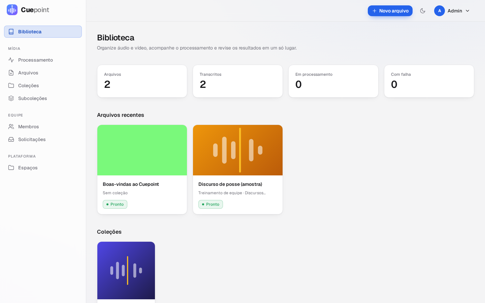
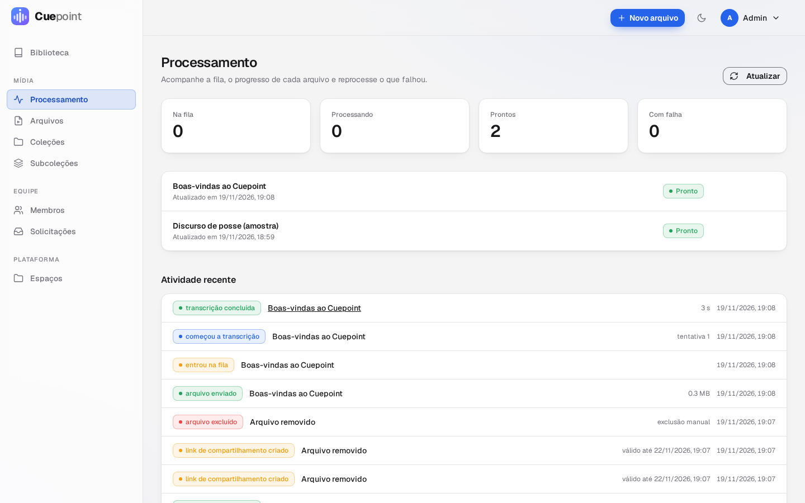
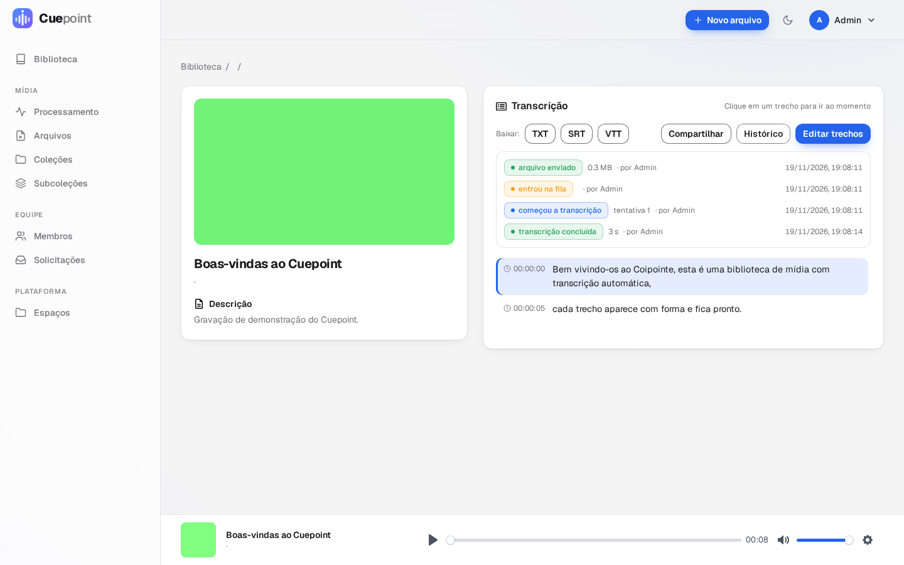
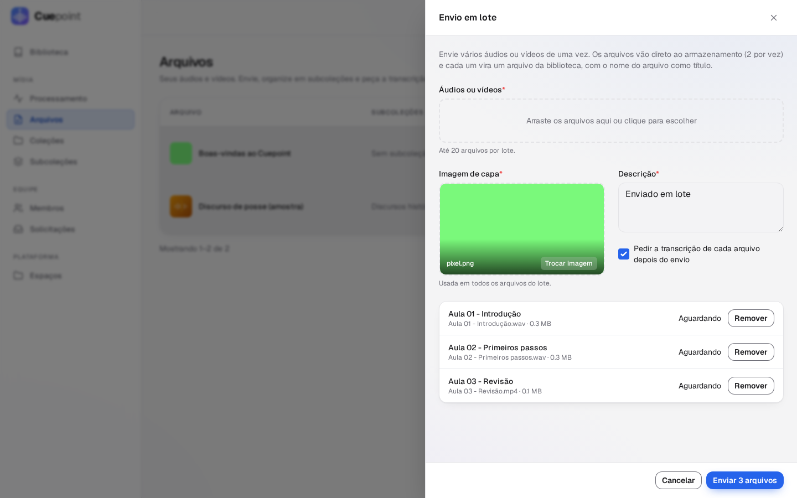
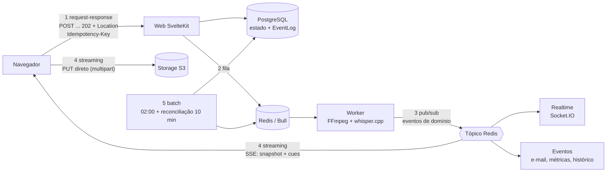

# Cuepoint — case de engenharia

Biblioteca de mídia com processamento automatizado: você envia áudio ou vídeo, o sistema transcreve em segundo plano, mostra o progresso ao vivo e deixa revisar, editar e compartilhar o resultado.

O ponto de partida foi um app simples que processava tudo dentro da requisição web, sem fila. O objetivo deste case é mostrar **decisões de engenharia com evidência**, guiadas pelos cinco padrões de comunicação entre sistemas distribuídos.

**Vídeo:** [`video/caminho-feliz-e-recuperacao.webm`](video/caminho-feliz-e-recuperacao.webm) — envio e transcrição ao vivo, revisão com trechos clicáveis e, depois, um arquivo que falha (áudio sem fala) e é recuperado trocando a mídia e reprocessando.

| Biblioteca | Processamento ao vivo |
|---|---|
|  |  |
| **Revisão: histórico por arquivo** | **Envio em lote** |
|  |  |

Tema escuro, edição de trechos, compartilhamento e espaços de trabalho estão em [`img/`](img/) (`*-escuro.png`).

## Arquitetura e os 5 padrões



| Padrão | Onde aparece | Garantia demonstrável |
|---|---|---|
| **Request-response** | Pedir transcrição responde `202` + `Location`; `GET /api/jobs/:id` | Replay com `Idempotency-Key` não cria segundo job; conflito responde 422 (ADR 0012) |
| **Fila de mensagens** | Bull + Redis, worker em processo separado | Worker derrubado no meio do job: retomada, `READY`, **uma** transcrição (teste de caos no CI) |
| **Pub/sub** | Eventos de domínio versionados; assinantes: tempo real, e-mail, métricas, histórico | Assinante com falha não afeta os outros; outbox + relay entregam "pelo menos uma vez" (ADR 10, 17) |
| **Streaming** | Trechos da transcrição por SSE com `snapshot` ao reconectar; envio direto ao storage em partes | Memória do web **não cresce** com o tamanho do arquivo (205 MB contra 996 MB em 200 MB) |
| **Batch** | Envio de até 20 arquivos; rotina das 02:00; reconciliação a cada 10 min; reprocesso em lote | Falha isolada por arquivo; jobs sem worker voltam para a fila sozinhos |

## Decisões que valem a leitura

Os ADRs (21 decisões, cada uma com contexto, alternativas e consequências) ficam na documentação interna do projeto (`docs/adr/`), que não é versionada neste repositório.

- **ADR 0002 — Worker separado.** O web valida, registra e enfileira; só o worker processa. Conclusão só depois de gravar o resultado.
- **ADR 0011 — Autorização central.** Antes, a checagem dependia de cada rota e o hash da senha do admin chegava ao navegador. Agora é uma regra única, com teste.
- **ADR 0012 e 0016 — SSE × Socket.IO.** SSE para acompanhar um job (reconecta sozinho, passa por proxy, abre com o estado persistido); Socket.IO só para o feed global, como dica de atualização.
- **ADR 0015 — Manter Bull, de propósito.** O gargalo medido é a CPU do whisper, não a fila; o ADR lista os gatilhos para migrar para BullMQ e o plano pronto.
- **ADR 0017 — Outbox e retenção opt-in.** Apagar mídia de cliente é irreversível, então a retenção vem desligada e com modo de simulação.
- **ADR 0018 — Renomear modelos sem quebrar o rollback.** `@@map` mantém as tabelas; a versão N e a N−1 convivem no mesmo banco.
- **ADR 0019 — Espaços de trabalho.** Isolamento por extensão do Prisma, não por consulta: um id de outro espaço devolve "não encontrado" mesmo se alguém esquecer o filtro.
- **ADR 0020 — Links temporários honestos.** Só o hash do token é guardado; o limite do desenho (objeto legível por quem souber a URL) está escrito.
- **ADR 0021 — Observabilidade sem SDK.** `traceparent` W3C do pedido HTTP até o log do worker, com alertas que dizem a ação a tomar.

## Resultados reais

Medidos em 2026-11-17 na stack de desenvolvimento (Docker, 10 CPUs / 8 GB, whisper `base`). Os números vêm do relatório de capacidade interno (`docs/capacity-report.md`), reproduzíveis com `scripts/capacity.py`.

| Medida | Resultado |
|---|---|
| Vazão de um worker | ≈ **7,5× o tempo real** (6 min de áudio em 48 s) |
| Saturação (12 jobs) | 1 worker 17 jobs/min → 2 workers 26,5 → **4 workers 28,8 (máximo)** → 6 workers 24,3 (piora) |
| Regra de dimensionamento | `workers ≈ CPUs / 2` |
| Memória do worker | 393 MB → pico 535 MB em 6 min de áudio |
| Worker derrubado no meio do job | retomado, 1 transcrição, sem duplicata |
| Backup e restauração (Postgres isolado) | contagens idênticas |

Testes em 2026-11-19: **131 unitários e 47 E2E** passando (os 2 testes que geram as mídias do case rodam à parte) na stack Docker, com E2E cobrindo login, criação, lote, vídeo, revisão e edição, compartilhamento, espaços de trabalho (isolamento e limites), pub/sub ponta a ponta e tema claro/escuro.

## Limites, ditos com honestidade

- Os workflows de CI, release e deploy foram validados como YAML e os comandos rodam localmente, mas **ainda não foram executados no GitHub**.
- A medição de carga é de uma máquina de desenvolvimento e serve para dimensionar e detectar regressão, não como promessa de produção.
- Não medidos: restauração dos objetos do storage, leitura concorrente na Biblioteca e modelos de whisper maiores que `base`; duração acima de 6 min.
- Formulários do painel ainda são rotas em iframe (ADR 0005): troca estética, sem ganho de produto.

## Como rodar

```bash
cp .env.example .env
docker compose -f docker-compose.dev.yml up -d --build      # web em http://localhost:3300
docker compose -f docker-compose.dev.yml exec web npx tsx prisma/seed-admin.ts
docker compose -f docker-compose.dev.yml exec web npx tsx prisma/seed-demo.ts
```

Para regenerar as imagens e o vídeo deste case: `E2E_CASE_DIR=<pasta> npx playwright test tests/e2e/case-media.spec.ts` (ver README do projeto).
